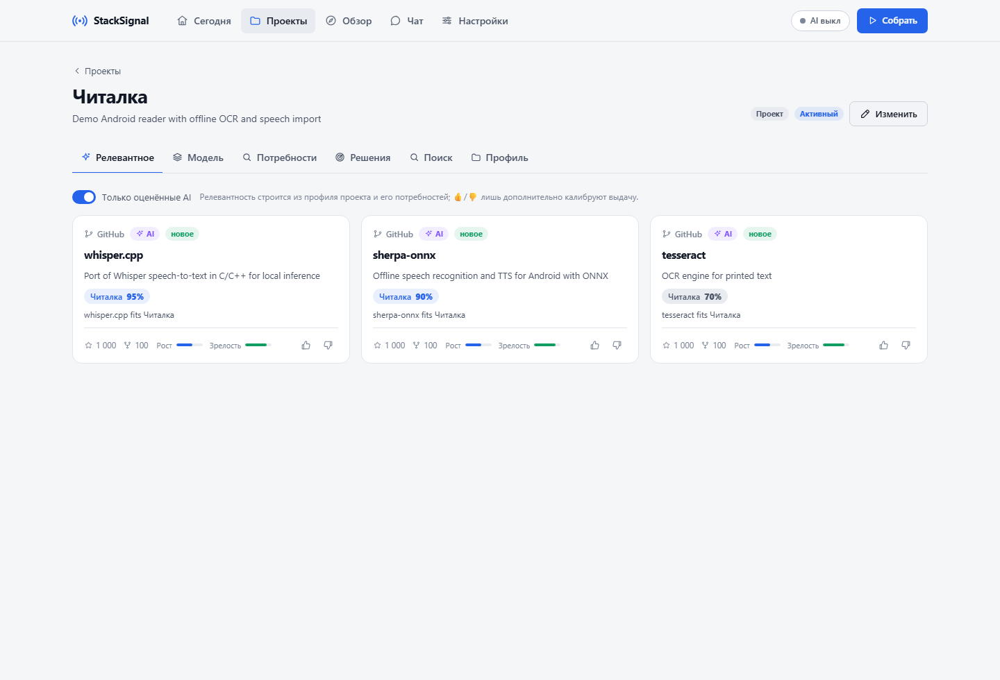

# StackSignal

**A local technology radar that turns project needs into checked decisions.**

StackSignal collects open-source tools, models and papers, matches them to your projects,
prepares small experiments and keeps the evidence and decisions together. It runs on your
computer with a Python/FastAPI backend, SQLite and a native JavaScript dashboard.



## Start here

| Read | What it answers |
| --- | --- |
| [Mission](docs/MISSION.md) | Who the service is for, the problem and the intended outcome |
| [Current state and handoff](docs/STATUS.md) | What works, current limits, where development stopped and the next task |
| [Architecture](docs/ARCHITECTURE.md) | Main components, data ownership and transaction boundaries |
| [Audit](docs/AUDIT.md) | Findings, fixes, actual validation and remaining risks |
| [User guide](docs/usage.md) | Daily workflow, screens, configuration and AI contract |
| [Operations](docs/OPERATIONS.md) | Portable launch, private storage, backup, updates and OS service integration |
| [Agent instructions](AGENTS.md) | Entry point for an agent joining the project |

The interface and detailed project documents are currently in Russian. Development is active.
This is a **single-user local service** with no authentication; run it on loopback in one process.

## Quick start

Requires **Python 3.11+** with `venv` and `pip`. From the repository root:

```text
python stacksignal.py run
```

Use `python3` if that is the name of your Python 3 interpreter. The same entry point works
on Windows, Linux and macOS; no shell activation, PowerShell, Bash or frontend build is needed.
It creates `.venv`, installs dependencies constrained by `backend/constraints.txt`, and creates
`.env` from the example only if none exists. Installation needs internet access. Unchanged
dependency files use the cached setup on subsequent starts.

Open **http://localhost:8000**. A new installation starts empty:

1. Open **Проекты → Сканировать папку**, review the proposed profiles and import your projects.
2. Review the description, current stack and concrete needs.
3. Press **Собрать** and inspect **Сегодня** or a project's relevant candidates.
4. Under **Потребности**, prepare a candidate check, copy/download its agent brief, and record
   the actual outcome with evidence. Confirming a need and adopting a tool are explicit decisions.

Collection and keyword matching work without AI. AI is disabled by default and requires a
separately configured gateway or a file-based agent workflow. The gateway is not bundled;
an arbitrary model API URL does not implement its contract. Optional local semantic search
downloads its embedding model on first use; set `EMBEDDINGS_ENABLED=0` to disable it.

## What is implemented

- Collection from GitHub, Hugging Face, arXiv, npm and PyPI, project queries and release/dependency monitoring.
- Reviewed folder scans, project profiles, technical models, needs and prerequisite graphs.
- Distinct heuristic, full AI and project-specific AI relevance with provenance.
- Search/chat over collected knowledge, briefings, project decisions, notes and history.
- Frozen experiment briefs, separately recorded results and staleness after requirements change.
- Scheduled daily collection while the service is running and an optional Telegram digest.

See [the current state](docs/STATUS.md) for the boundary between working features and planned work.

## Configuration and private data

Copy settings from [.env.example](.env.example). Credentials and runtime files are ignored by Git.
`STACKSIGNAL_PRIVATE_DIR` can keep the private `.env` and `data/` outside the checkout;
the root `.env` can contain only this pointer. Existing state is moved separately while the service is stopped.

```text
python stacksignal.py doctor
python stacksignal.py backup
```

The backup command snapshots the configured SQLite database; back up the remaining private
files separately. Project profiles/content are shared with the configured gateway or agent
when analysis runs. Read [operations](docs/OPERATIONS.md) and [security](SECURITY.md).
Screenshots and examples in this repository use fictional data.

## Development and publication

```text
python stacksignal.py setup --dev
python stacksignal.py test
python stacksignal.py setup --browser
python stacksignal.py test --browser
python scripts/public_release.py --check
```

See [CONTRIBUTING.md](CONTRIBUTING.md) and [agent workflows](docs/AGENT-WORKFLOWS.md).
The [publication guide](docs/public-release.md) explains public source snapshots and history
review. Public snapshots contain the current source without runtime data or Git history.

## License

[MIT](LICENSE). Third-party packages, models and collected content retain their own licenses and terms.
