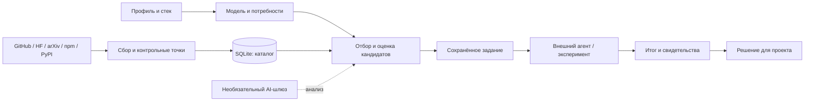

# Архитектура

## Среда выполнения

Python 3.11+, FastAPI, SQLAlchemy, SQLite с WAL и Alembic. Backend обслуживает и API,
и статический frontend. Интерфейс написан на обычных JavaScript ES modules; отдельной
сборки и Node нет. Запуск — `python stacksignal.py run`, один процесс Uvicorn на `127.0.0.1`.

## Карта кода

| Путь | Ответственность |
| --- | --- |
| `stacksignal.py` | Стандартная библиотека Python: venv, установка, запуск, диагностика, тесты и вызов служебных команд |
| `backend/app/main.py` | FastAPI, жизненный цикл, миграции, старт расписания, статические файлы |
| `backend/app/config.py`, `storage.py`, `db.py` | Настройки и порядок приоритета, фактический путь SQLite, соединения/сессии |
| `backend/app/routers/` | HTTP-граница; схема API доступна на `/docs` и `/openapi.json` |
| `pipeline.py`, `discovery.py`, `collectors/` | Получение данных, нормализация, обновление объектов и этапы сбора |
| `quality.py`, `scoring.py`, `enrichment.py`, `entities.py` | Качество, технические оценки, анализ и связи одной технологии между источниками |
| `profile_import.py`, `lockfiles.py`, `project_directory.py` | Ограниченное чтение локальных деклараций, зависимостей и папок проектов |
| `project_intelligence.py`, `project_model.py`, `needs.py` | Понимание проекта, актуальность, потребности и граф предварительных задач |
| `need_analysis.py`, `experiments.py` | Оценки пар «потребность/находка» и проверки с неизменяемым исходным заданием |
| `chat.py`, `search_index.py`, `embeddings.py`, `retrieval.py` | FTS/BM25, необязательные локальные эмбеддинги и RRF |
| `decisions.py`, `feedback.py`, `revisit.py`, `preference_learning.py` | Явные решения, дополнительная обратная связь и пересмотр |
| `ai_client.py`, `ai_analysis.py`, `ai_schemas.py` | Контракт шлюза, бюджет/кеш/происхождение AI-ответа и строгая валидация |
| `agent_analysis.py`, `agent_relevance.py` | Экспорт/применение ответов файлового агента с отпечатками исходных данных |
| `scheduler.py`, `digest.py`, `telegram.py` | Ежедневный сбор и настроенная пользователем доставка дайджеста |
| `frontend/js/views/`, `frontend/js/components/` | Экраны и компоненты; состояние/HTTP/DOM вынесены в небольшие общие модули |
| `backend/alembic/versions/` | Версионируемая схема данных |
| `backend/tests/`, `backend/e2e/` | Изолированные проверки backend и реальный браузер с отдельной базой |
| `scripts/` | Проверка/экспорт публичного исходного кода, приватный перенос истории, необязательный экспорт аккаунта |

## Основные границы данных

- `Project` и зависимости описывают пользовательский контекст. Личный абсолютный путь проекта хранится только в runtime.
- `ProjectTechnicalModel` — производный снимок понимания; отпечаток профиля показывает его устаревание.
- `Need` задаёт задачу; `ContextNeed` привязывает её к проекту с собственными ограничениями и критерием проверки. `NeedDependency` задаёт необходимый предварительный результат внутри одного проекта.
- `Item` — находка определённого источника. `ItemProjectRelevance`, `ItemAnalysisState` и `NeedAssessment` сохраняют оценки и их происхождение.
- `ItemProjectDecision`, `ItemFeedback`, `StatusHistory`, `NeedEvent` сохраняют решения и события пользователя отдельно от анализа.
- `NeedExperiment` хранит исходный контекст, задание и отдельно записанный итог. Активные дубли ограничены ключом; версия строки защищает завершённый результат от конкурентной перезаписи.
- `CollectionRun` содержит состояние сбора и этапы. `AIAnalysis` — кеш/диагностика отдельных AI-вызовов.

## Транзакции и восстановление

Сбор фиксирует запись запуска и отдельные завершённые этапы. Ошибка следующего этапа
сохраняет предыдущие контрольные точки (`partial`). Это не постоянная очередь заданий:
блокировка запуска находится в памяти процесса, а принудительное завершение может оставить
старую запись `running`. Запуск нескольких серверных процессов для одной установки не поддерживается.

Удалённые вызовы не должны удерживать SQLite write transaction. Ответы агентов проверяются
по схеме и отпечаткам содержания/проекта; изменившиеся данные оставляют работу ожидающей
повторного анализа. Новые/изменённые таблицы требуют миграции Alembic.

## Конфигурация и приватность

Приоритет: переменные процесса → `.env` в корне → `.env` в `STACKSIGNAL_PRIVATE_DIR`.
По умолчанию runtime находится в `data/`; отдельная личная папка содержит собственные
`.env` и `data/`. `STACKSIGNAL_DATABASE_URL` может явно задать файловую SQLite-базу.
Прямое чтение реестров ОС отсутствует.

Сканирование читает README и известные манифесты/lock-файлы с ограничениями размера и
глубины, пропускает ссылки/служебные каталоги и показывает предложение перед импортом.
AI-шлюз получает профили и содержание, необходимые выбранному анализу; локальный агент
видит экспортированные файлы. Правила эксплуатации — [OPERATIONS.md](OPERATIONS.md).

## Текущие ограничения алгоритмов

FTS и семантическое ранжирование используются в чате. Отбор `needs.shortlist()` остаётся
лексическим, с ограниченным списком и отдельной AI-оценкой. Наличие модуля эмбеддингов
не означает семантический поиск во всех экранах. Пользовательские голоса уточняют ранжирование,
а критерий полезности следует из самого проекта и проверяемых результатов.
